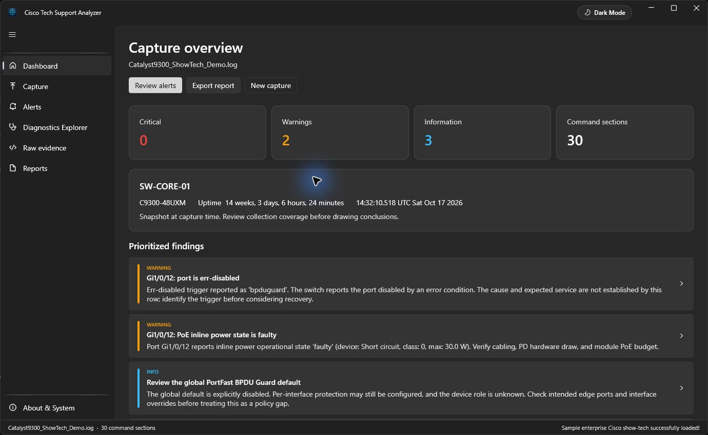
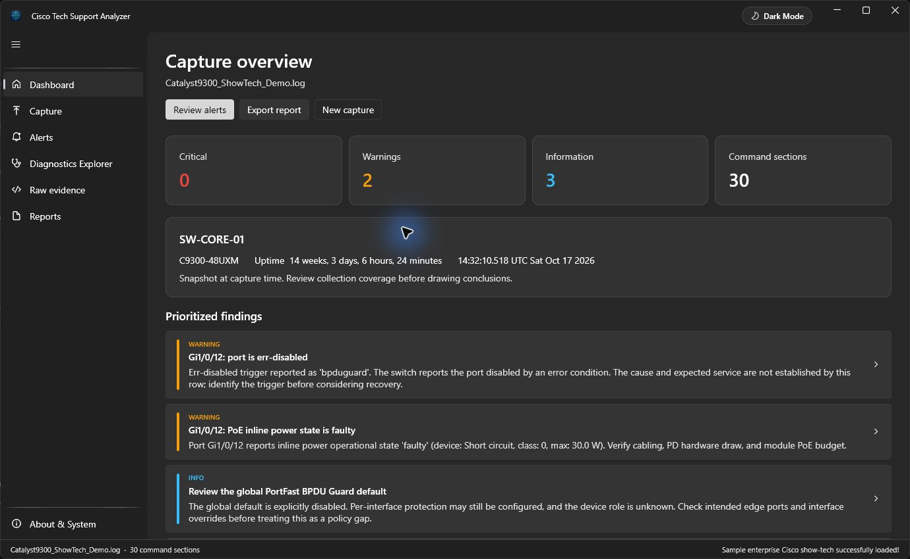
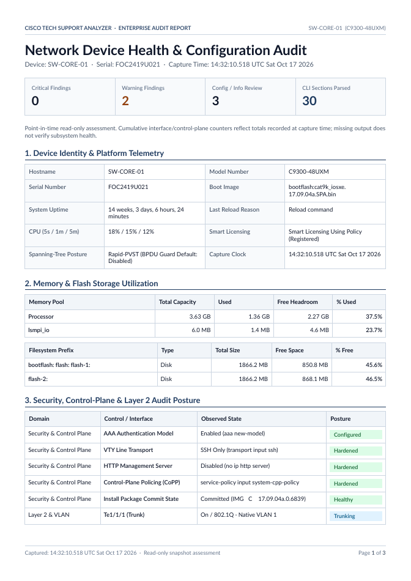

# Cisco Tech Support Analyzer

Assess Cisco IOS and IOS XE switches and routers from saved `show tech-support` captures or read-only SSH sessions. Audit device health, inspect the exact CLI evidence behind every warning, explore parsed diagnostic tables, and export presentation-ready reports.

[](CHANGELOG.md)
[](#download)
[](https://dotnet.microsoft.com/)
[](LICENSE.md)
[](#support-and-license)

---

[Download](#download) · [Quickstart](#run-your-first-assessment) · [Capture & SSH](#bring-your-own-capture) · [Alert Coverage](#alert-coverage) · [Diagnostics Explorer](#diagnostics-explorer) · [Reports](#reports) · [Changelog](CHANGELOG.md)



*Dashboard is the opening workspace. Load a saved capture, connect over live SSH, or try the built-in sample switch to evaluate device health and trace prioritized findings.*

> [!NOTE]
> **What's New in v2.2.0**
> - **Health Scorecard Dashboard:** Executive health status banner (`HEALTHY`, `ATTENTION REQUIRED`, `CRITICAL`), three telemetry barometers (Audit Snapshot, Buffer Pressure Index, Hardware & Reload Integrity), quick-stat KPI cards, and one-click `CLI Evidence` inspection.
> - **Streamlined Capture Workspace:** Two-column offline log intake with file readiness indicators alongside automated Live SSH collection.
> - **43 Enterprise Alert Checks & Modal Inspector:** Prioritized findings across security, Layer 2, power/PoE, StackWise, memory/TCAM, and reliability with a solid modal detail overlay and direct source-line jumping.
> - **Presentation-Grade Reports:** Upgraded PDF exports with executive summary strips and dark terminal CLI evidence blocks, plus editable Word (`.docx`), standalone HTML, and structured JSON.
> - [View complete changes in the Changelog](CHANGELOG.md)

---

<a id="how-to-build--run"></a>
<a id="running-the-standalone-executable"></a>

## Download

Choose the Windows package that fits your environment. All downloads are self-contained and bundle the .NET 8 runtime—no separate runtime installation is required.

| Platform | Architecture | Package | How to Start |
| :--- | :---: | :--- | :--- |
| **Windows** | x64 (Installer) | `CiscoTechSupportAnalyzer-2.2.0-win-x64-setup.exe` | Run the setup wizard; launches from the Start menu or optional Desktop shortcut. |
| **Windows** | x64 (Portable) | `CiscoTechSupportAnalyzer-2.2.0-win-x64.zip` | Extract the entire ZIP to a folder and run `CiscoTechSupportAnalyzer.WPF.exe`. |

[View all available release packages and checksums](https://github.com/LazyAutomatar/CiscoTechSupportAnalyzer/releases)

> [!TIP]
> - **Appearance & Navigation:** Switch between Dark Mode and Light Mode from the title bar toggle. Use <kbd>Ctrl</kbd> + <kbd>1</kbd> through <kbd>Ctrl</kbd> + <kbd>6</kbd> to jump between Dashboard, Capture, Alerts, Diagnostics Explorer, Raw Evidence, and Reports.
> - **Windows SmartScreen:** If Windows prompts on an unsigned local/community installer, choose *More info → Run anyway*.
> - **About & Updates:** Open **About & System** in the sidebar footer to view build details, check the release feed for updates, and browse the bundled offline changelog.

---

## Run your first assessment

```text
  ┌──────────────────┐      ┌──────────────────┐      ┌──────────────────┐      ┌──────────────────┐
  │  1. Ingestion    │ ───► │  2. Correlation  │ ───► │  3. Diagnostics  │ ───► │  4. Reports      │
  │  Logs or SSH     │      │  43 Alert Checks │      │  5 Domain Tabs   │      │  PDF, DOCX, HTML │
  └──────────────────┘      └──────────────────┘      └──────────────────┘      └──────────────────┘
```

You can test the complete workflow using the built-in sample capture before connecting to a switch or importing real logs:

1. On **Dashboard**, select **Load sample capture**. The sample switch loads with pre-parsed command sections, telemetry barometers, and prioritized findings.
2. Select **Review alerts** (or press <kbd>Ctrl</kbd> + <kbd>3</kbd>) and search for `Gi1/0/12`. Two warnings reference that port—one for err-disabled shutdown and one for a Power over Ethernet (PoE) fault.
3. Click the PoE warning to open its detail overlay and select **Open in Raw Evidence**. The viewer jumps directly to the exact line in `show power inline` showing `faulty`, `0.0` watts drawn, and `Short circuit`.
4. Return to **Alerts** and inspect the err-disabled warning. Its CLI evidence identifies **BPDU Guard** as the shutdown cause, giving you verified source evidence for both faults.

---

## Bring your own capture

Navigate to **Capture** (<kbd>Ctrl</kbd> + <kbd>2</kbd>) and choose your collection method:

- **Log files (Air-Gapped Assessment):** Click **Browse** to select `.txt`, `.log`, `.cfg`, or `.zip` files from a single device and collection session, verify readiness in the right-hand launch card, and click **Run Diagnostic Assessment →**.
- **Live SSH:** Enter the switch IP or hostname, SSH port (`22`), username, password, and optional enable secret. Choose targeted diagnostic profiling or a full `show tech-support` capture, then select **Run Live Network Assessment →**.
- **Required CLI Commands Guide:** If you are collecting terminal output manually, open **Capture → Required CLI Commands Guide** to copy the recommended commands.

> [!IMPORTANT]
> **Capture best practices:**
> - Run `terminal length 0` before collecting manual CLI logs so `--More--` prompts do not truncate output.
> - Keep command headings intact (for example, `Switch# show power inline` or `------------------ show running-config ------------------`). If **Raw evidence** shows only a single `show tech-support` block, verify that command headers were preserved in the file.

---

## Alert coverage

The analyzer evaluates **43 alert types** across five operational domains. Findings count individual occurrences, so the same issue on two interfaces generates separate actionable alerts.

| Area | Alert Types | Examples You Might Investigate |
| :--- | :---: | :--- |
| **Configuration and management** | 8 | Telnet access on VTY lines, enabled HTTP server, SNMPv1/v2c communities, missing AAA, cleartext credentials |
| **Interfaces and Layer 2** | 12 | Err-disabled ports, connected half-duplex links, missing or suspended access VLANs, native VLAN mismatches, DTP negotiation, MAC flaps |
| **Power, stack and sensors** | 8 | PoE inline faults, low PoE budget headroom, StackWise half-ring or member sync issues, PSU and thermal sensor faults |
| **Resources and storage** | 6 | Low flash filesystem space, buffer pool allocation failures, high CPU load, ASIC TCAM utilization pressure |
| **Reliability and logs** | 9 | Abnormal reload history, crashinfo artifacts, clock synchronization events, Smart Licensing DNS/communication failures |

If a capture produces **zero findings**, review **Reports → Evidence and coverage** to confirm which baseline commands were present or missing in your capture. For command mapping details, see [Evidence used by the checks](docs/capture-assessment.md).

---

## Trace a finding

In **Alerts**, filter by severity (`All`, `Critical`, `Warning`, `Info`) or search by interface, VLAN, rule ID, or command. Selecting any row opens the detail overlay with the triggered CLI snippet, potential impact, engineering observation, and verification commands.



- **Verify timing:** An err-disabled status reflects the state at capture time, whereas syslog entries record historical events. Compare log timestamps against interface tables before escalating.
- **Jump to raw evidence:** Click **Open in Raw Evidence** inside any alert card to open **Raw evidence** (<kbd>Ctrl</kbd> + <kbd>5</kbd>) scrolled directly to the matching command section and line number.
- **Hand off next checks:** Use **Copy summary** for ticket notes or **Copy checks** to copy read-only verification CLI commands for live device triage.

---

## Diagnostics explorer

Open **Diagnostics Explorer** (<kbd>Ctrl</kbd> + <kbd>4</kbd>) to search across parsed switch tables organized into five tabs:

| Tab | Parsed Operational Tables |
| :--- | :--- |
| **Interfaces & Layer 2** | Interface status overview, err-disabled interfaces, non-zero drops/anomalies, MAC flap events, MAC address table, Spanning Tree summary, and CDP neighbors. |
| **Hardware & Power** | Hardware modules, power supply redundancy, PoE inline power budgets, optical transceivers, environmental sensors, and StackWise status. |
| **CPU, Memory & Storage** | Control-plane CPU utilization, System DRAM & Processor memory pools, flash filesystems, top processes, and TCAM utilization. |
| **Redundancy & Crashes** | Reload history, crashinfo files, and chassis redundancy state. |
| **Logging & Licenses** | Retained syslog message frequency, NTP/clock status, and Smart Licensing state. |

---

## Reports

Open **Reports** (<kbd>Ctrl</kbd> + <kbd>6</kbd>) to review **Evidence and coverage** and export finished handovers:

| Deliverable | Format | What You Get |
| :--- | :---: | :--- |
| **Assessment PDF** | `.pdf` | Executive title banner, severity distribution strip, KPI cards, device telemetry, security/Layer 2 posture tables, terminal-styled CLI evidence cards, and collection coverage gaps. |
| **Editable Word** | `.docx` | Editable Microsoft Word assessment with formatted tables, device specs, posture summaries, and per-finding details. |
| **Standalone HTML** | `.html` | Self-contained browser-readable report with direct links from findings into the indexed command output. |
| **Structured JSON** | `.json` | Complete machine-readable findings, parsed tables, coverage notes, and raw command sections with line references. |

> [!CAUTION]
> **Sanitize before external sharing:**
> HTML and JSON exports include full captured command sections. If your capture contains `show running-config`, review and redact credentials or sensitive site details before distributing externally.

<details>
<summary><b>See the first page of the sample PDF</b></summary>



</details>

---

<a id="about-updates-and-support"></a>

## Support and license

Cisco Tech Support Analyzer is closed-source freeware created and maintained by **Yash Nalawde**. Personal and commercial use and redistribution of unmodified official packages are permitted under the terms of the [EULA](EULA.txt) and [License](LICENSE.md).

- **Bug Reports & Feature Requests:** Include the application version, finding title, command name, and a short redacted CLI excerpt. [GitHub Issues](https://github.com/LazyAutomatar/CiscoTechSupportAnalyzer/issues) · [Security Reporting](SECURITY.md) · [Changelog](CHANGELOG.md)
- **Developer Links:** [GitHub](https://github.com/LazyAutomatar) · [LinkedIn](https://www.linkedin.com/in/yash-nalawde)
